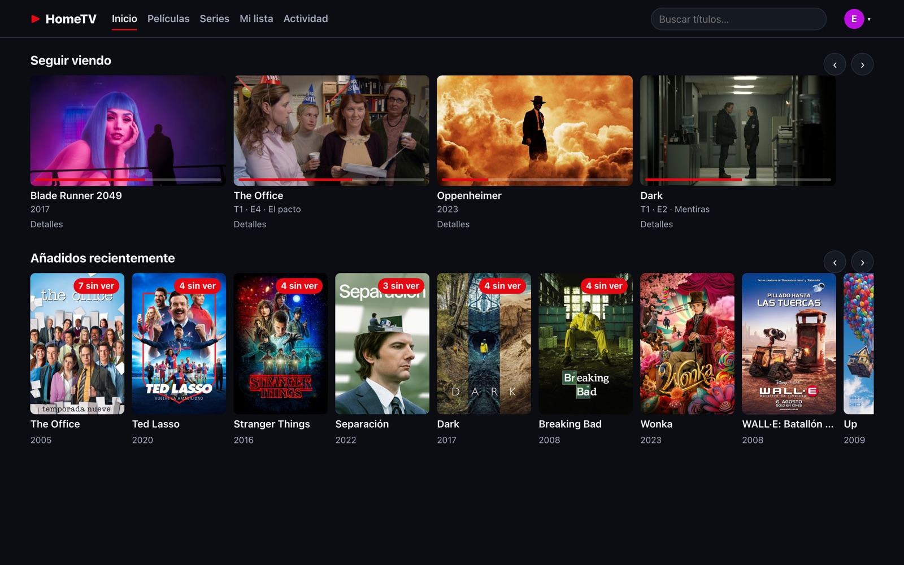
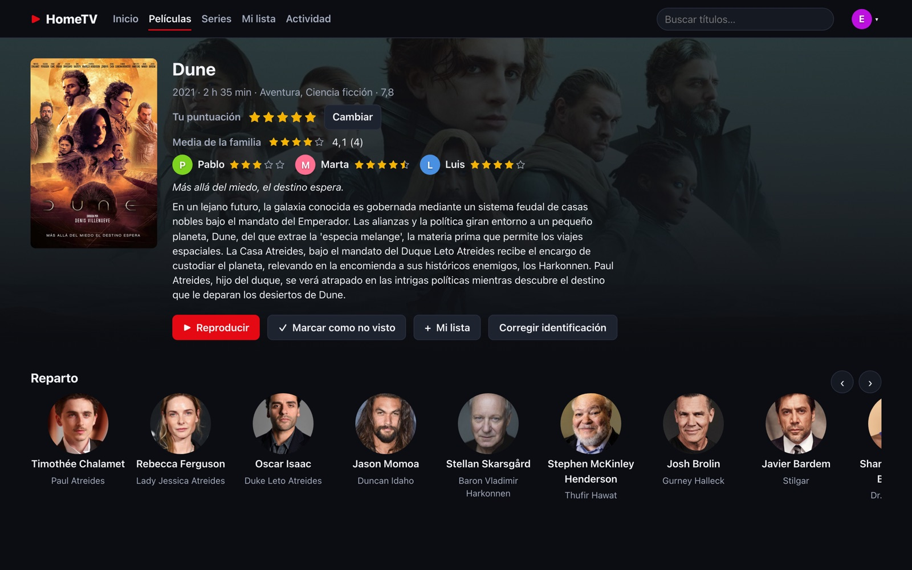
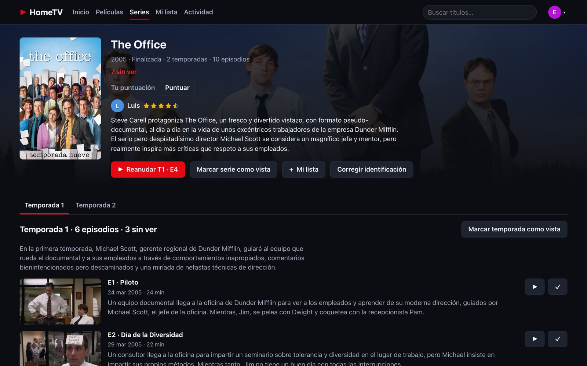
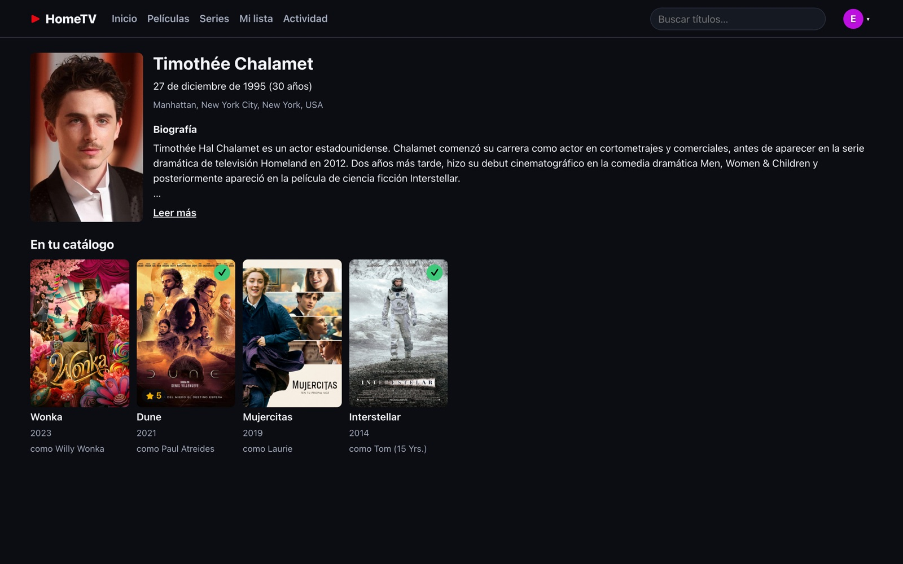
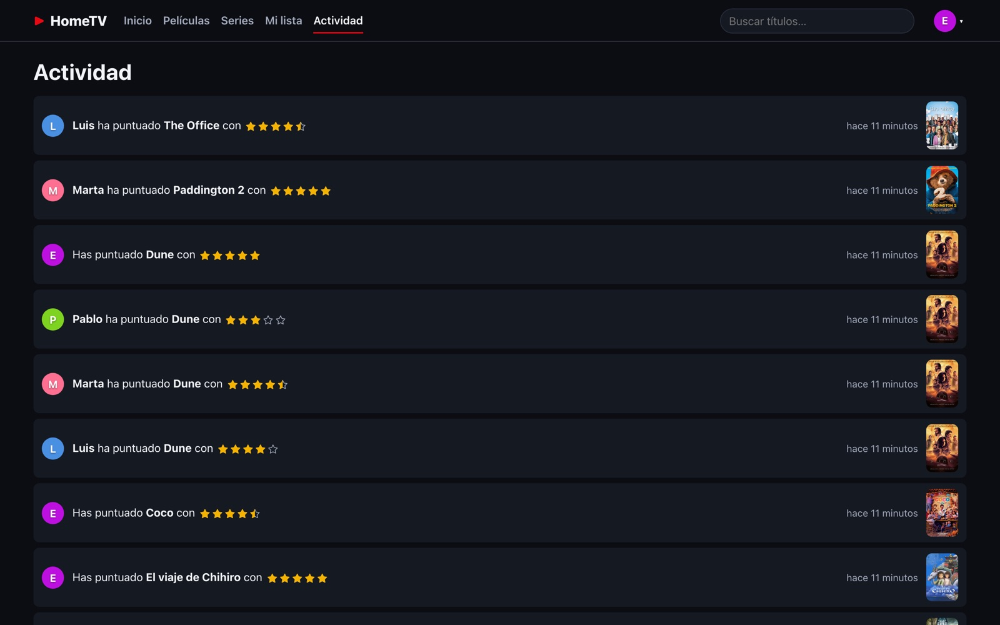
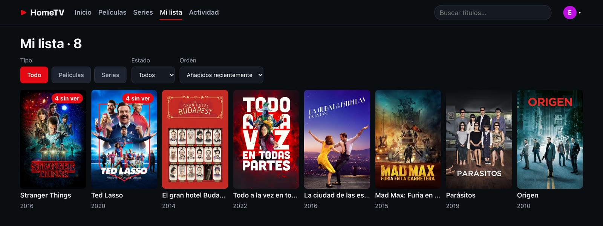
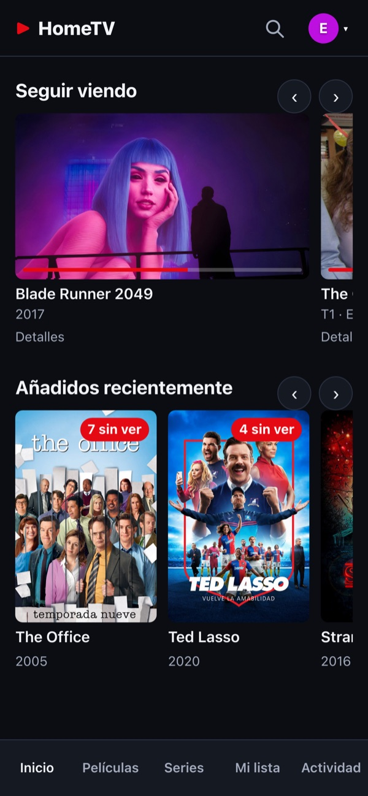
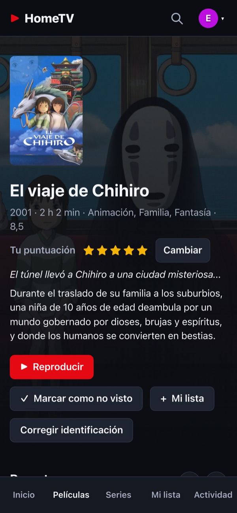
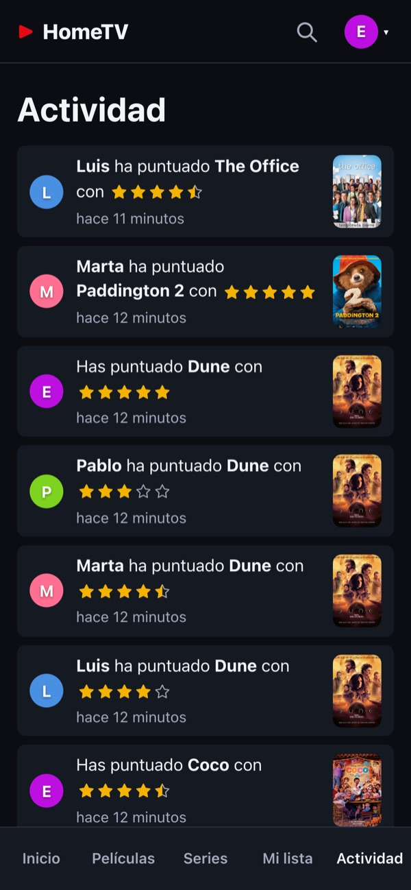

# HomeTV

**A self-hosted media server for one household: your films and shows, on every screen at home.**

[](https://www.python.org/)
[](https://fastapi.tiangolo.com/)
[](https://react.dev/)
[](tv/README.md)
[](https://tailscale.com/)
[](LICENSE)

[](docs/images/web-home.jpg)

_Home screen of the web app: pick up where you left off, see what's new and what's still unwatched._

HomeTV indexes the films and TV shows on a local disk, fetches metadata and artwork from TMDB,
keeps a watch history per profile, and plays video in the browser and on Android TV / Google TV.
Files play directly when the device supports them; otherwise they're converted on the fly. It's
only reachable over your Tailscale tailnet, with HTTPS, and the whole interface is in Spanish.

## Contents

- [Highlights](#highlights)
- [Screenshots](#screenshots)
- [How it works](#how-it-works)
- [Getting started](#getting-started)
- [Development](#development)
- [Configuration](#configuration)
- [Repository layout](#repository-layout)
- [Documentation](#documentation)
- [Acknowledgements and license](#acknowledgements-and-license)

## Highlights

- **Your library, automatically.** Drop files in your folders: HomeTV identifies them with
  TMDB (titles, posters, synopses, cast, in Spanish) and picks up new or changed files about a
  minute after a copy ends.
- **One profile per person.** Each profile has its own progress, "Seguir viendo", watched
  marks and "Mi lista" (a watchlist with filters and sorting). Admin actions are behind a PIN.
- **Ratings and household activity.** Rate films and shows from ½ to 5 stars; HomeTV offers it
  when you finish a title. Every page shows the household average and an "Actividad" feed
  shows what everyone rated.
- **Cast pages.** Tap an actor to see their biography and everything else they appear in that
  you have at home.
- **Plays almost anything.** Direct play when the device can handle the file; otherwise a live
  HLS remux: video is copied untouched (no transcoding), audio is converted only when needed.
  Subtitles from inside the file or next to it, multiple audio tracks and versions.
- **Every screen.** A responsive web app for computers, tablets and phones, and a native
  Android TV / Google TV app driven entirely by the remote.
- **Private by design.** Runs in Docker next to a Tailscale sidecar: no open ports, nothing on
  the public internet.

## Screenshots

<table>
  <tr>
    <td width="50%"><a href="docs/images/web-film.jpg"></a></td>
    <td width="50%"><a href="docs/images/web-show.jpg"></a></td>
  </tr>
  <tr>
    <td><em>Film page: your rating, the household's, and the cast.</em></td>
    <td><em>Show page: resume where you left off, season by season.</em></td>
  </tr>
  <tr>
    <td><a href="docs/images/web-person.jpg"></a></td>
    <td><a href="docs/images/web-activity.jpg"></a></td>
  </tr>
  <tr>
    <td><em>Cast pages: the biography and what else they're in, at home.</em></td>
    <td><em>"Actividad": what everyone in the house has been rating.</em></td>
  </tr>
  <tr>
    <td colspan="2"><a href="docs/images/web-watchlist.jpg"></a></td>
  </tr>
  <tr>
    <td colspan="2"><em>"Mi lista": a watchlist per profile, filtered by type and watched status.</em></td>
  </tr>
</table>

On a phone, the same web app switches to a bottom tab bar:

<p align="center">
  &nbsp;
  &nbsp;
  
</p>

## How it works

```
 Films/ Series/ (read-only)          ┌────────────── Docker host ──────────────┐
        │                            │  hometv (FastAPI + SQLite + ffmpeg)     │
        └──── scan + watch ─────────▶│    ├─ /api      REST API (OpenAPI)      │◀── TMDB
                                     │    └─ /         web app (React)         │
                                     │  tailscale sidecar (HTTPS, no ports)    │
                                     └───────────────────┬─────────────────────┘
                                                         │ tailnet
                                ┌────────────────────────┼─────────────────────┐
                           web browser               Android TV            iPad / phone
```

| Piece | What it does |
| --- | --- |
| **Scanner** | Walks the library folders, parses file names (guessit), probes them with ffprobe and links them to films, shows and episodes. On Linux, inotify triggers a scan of just the changed folder. |
| **Metadata** | Matches titles on TMDB (Spanish first, with fallbacks), caches posters, backdrops, cast and biographies locally. |
| **Playback** | Each client reports what it can decode. The server answers "play the original file" (byte-range streaming) or starts an HLS session: ffmpeg remuxes the video into fMP4 segments cut at keyframes and converts the audio only when needed. |
| **Clients** | The web app (React + hls.js) and the Android TV app (Compose for TV + Media3 ExoPlayer, with libVLC as the fallback player for formats the TV can't decode) share the same REST API. |

## Getting started

### Run the server

Step-by-step guides for [Linux](docs/server-installation-linux.md) and
[Windows](docs/server-installation-windows.md) (Docker Desktop + WSL 2). In short:

1. Set up the tailnet ACL and create a Tailscale auth key.
2. `cp deploy/.env.example deploy/.env` and fill in `TS_AUTHKEY`, `TMDB_API_KEY` and `MEDIA_DIR`.
3. Start it from `deploy/`:

   ```bash
   docker compose up -d --build
   ```

4. Open `https://hometv.<tailnet>.ts.net`, create the admin profile and choose the film and show
   folders in **Administración → Bibliotecas**.

The operator reference (setup, day-to-day operations, every setting) is [`deploy/README.md`](deploy/README.md).

### Watch

| Where | How |
| --- | --- |
| Computer, tablet, phone | Any modern browser on a device in your tailnet. |
| Android TV / Google TV | Install the APK: [TV app guide](docs/tv-app-installation.md). |
| iPad | The web app in Safari, added to the home screen: [iPad guide](docs/ipad-installation.md). |

## Development

Requires [uv](https://docs.astral.sh/uv/) and Node 24 (`web/.nvmrc`). ffmpeg/ffprobe are
optional: the server integration tests are skipped without them. The TV app needs JDK 21 and an
Android SDK with `platforms;android-35` + `build-tools;35.0.0`; the Makefile defaults
`JAVA_HOME`/`ANDROID_HOME` to the Homebrew paths (`openjdk@21`, `android-commandlinetools`) when
they are unset.

```bash
make install   # uv sync (server) + npm ci (web)
make test      # server: unit + service + API (+ integration with ffmpeg); web suite; TV JVM tests
make lint      # ruff check + format check (make format fixes), mypy, web typecheck + ESLint, TV Android lint
make run       # dev server on http://127.0.0.1:8000, data in .dev-data/, serves web/dist
make perf      # browse-latency benchmark (not part of make test)
```

**Web UI** (two terminals):

```bash
make run       # API on 127.0.0.1:8000
make web-dev   # Vite on http://localhost:5173, proxies /api to the server (HOMETV_API_TARGET)
```

`make web-build` builds `web/dist`; `make run` then serves it at `/` (without a build, `/` shows
a "Web UI not built" page). `make web-test` runs the Vitest suite (no network).

**Demo environment:** `scripts/create-environment.sh` starts a server with a generated demo
library (admin "Admin", PIN 1234) that serves `web/dist`; `--tv` also builds and installs the TV
debug APK.

**End-to-end smoke** (optional, Playwright): `npx playwright install chromium` once, then
`HOMETV_E2E_URL=http://127.0.0.1:8000 make web-e2e` (add `HOMETV_E2E_FILM=Dune` for the demo
library).

**TV app:** `make tv-test` (JVM tests, including the Robolectric focus tests), `make tv-lint`,
`make tv-build` (signed release APK; needs `tv/keystore.properties`). Install it with
`adb install -r`; see the [TV app guide](docs/tv-app-installation.md).

Contributor conventions (strict TDD, DB write rules, test layout) are in [`CLAUDE.md`](CLAUDE.md) and the per-area [`server/CLAUDE.md`](server/CLAUDE.md), [`web/CLAUDE.md`](web/CLAUDE.md) and [`tv/CLAUDE.md`](tv/CLAUDE.md).
The release version lives in [`version.txt`](version.txt), the only file a version bump changes (the
server, the Docker image and the TV app read it); changes are listed in
[`CHANGELOG.md`](CHANGELOG.md).

## Configuration

Settings come from `HOMETV_*` environment variables, then an optional YAML file
(`HOMETV_CONFIG_FILE`, or `{data_dir}/config.yaml`), then defaults. The ones you're most likely
to touch:

| Setting | Default | Purpose |
| --- | --- | --- |
| `HOMETV_TMDB_API_KEY` | none | TMDB metadata and artwork. |
| `HOMETV_DATA_DIR` | `/data` | Database, artwork cache, HLS scratch space. |
| `HOMETV_MAX_SESSIONS` | 4 | Simultaneous conversion (HLS) sessions. |
| `HOMETV_MEDIA_BROWSE_ROOT` | `/media` | Base of the folder browser in Bibliotecas. |
| `HOMETV_SCAN_WATCH_ENABLED` | on | Change detection on Linux hosts. |
| `HOMETV_SCAN_WATCH_QUIET_SECONDS` | 30 | Quiet time after a copy before scanning. |

The film and show folders are managed in the web app, **Administración → Bibliotecas** (stored
in the database). `HOMETV_FILMS_PATHS` / `HOMETV_SHOWS_PATHS` are only read on the first start to
seed them, then ignored. Full list: the
[Configuration reference](deploy/README.md#configuration-reference).

## Repository layout

| Path | Contents |
| --- | --- |
| [`server/`](server) | The HomeTV server: Python 3.12, FastAPI, SQLAlchemy + SQLite, Alembic, ffmpeg. REST API under `/api` (OpenAPI docs at `/api/docs`); also serves the web app. |
| [`web/`](web) | The web app: React 18 + TypeScript + Vite, TanStack Query, hls.js. Built into `web/dist`. |
| [`tv/`](tv) | The Android TV / Google TV app: Kotlin, Compose for TV, Media3 ExoPlayer + libVLC (ARM-only APK). Viewer-only. See [`tv/README.md`](tv/README.md). |
| [`deploy/`](deploy) | Docker image and Compose stack (the server plus a Tailscale sidecar). |
| [`docs/`](docs) | User guides and the screenshots in this README. |
| [`scripts/`](scripts) | `create-environment.sh`: local demo environment. |

## Documentation

| Document | What's in it |
| --- | --- |
| [Server on Linux](docs/server-installation-linux.md) | Installing Docker, Tailscale and HomeTV on a Linux machine. |
| [Server on Windows](docs/server-installation-windows.md) | The same with Docker Desktop + WSL 2. |
| [Android TV app](docs/tv-app-installation.md) | Installing the APK and connecting it to the server. |
| [iPad](docs/ipad-installation.md) | Using the web app in Safari over Tailscale (there is no iOS app). |
| [Deployment reference](deploy/README.md) | Operator notes and every `HOMETV_*` setting. |
| [TV app development](tv/README.md) | Building and testing the TV app. |

## Acknowledgements and license

Built on [FastAPI](https://fastapi.tiangolo.com/), [SQLAlchemy](https://www.sqlalchemy.org/),
[guessit](https://github.com/guessit-io/guessit), [FFmpeg](https://ffmpeg.org/),
[React](https://react.dev/), [TanStack Query](https://tanstack.com/query),
[hls.js](https://github.com/video-dev/hls.js), [Jetpack Compose for TV](https://developer.android.com/training/tv/playback/compose),
[Media3 ExoPlayer](https://developer.android.com/media/media3/exoplayer),
[libVLC](https://www.videolan.org/vlc/libvlc.html) and [Tailscale](https://tailscale.com/).

The TV app bundles libVLC for Android (`org.videolan.android:libvlc-all`, © VideoLAN and VLC authors),
unmodified and dynamically linked, under the GNU LGPL v2.1 or later. Its notice, source links and the
licence text ship in the app: Ajustes → Acerca de → Licencias de código abierto
(`tv/app/src/main/res/raw/third_party_notices.txt`).

<a href="https://www.themoviedb.org/"></a>
This product uses the TMDB API but is not endorsed or certified by TMDB. Posters, artwork and
metadata in the screenshots come from TMDB and belong to their respective owners.

HomeTV is released under the [MIT License](LICENSE).
